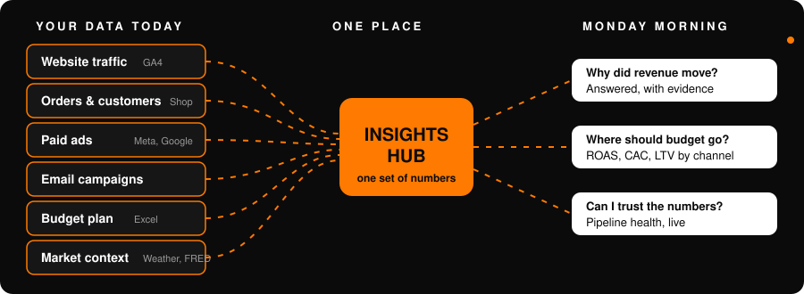
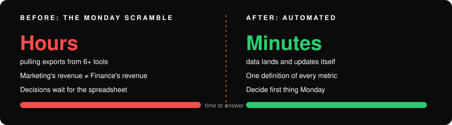
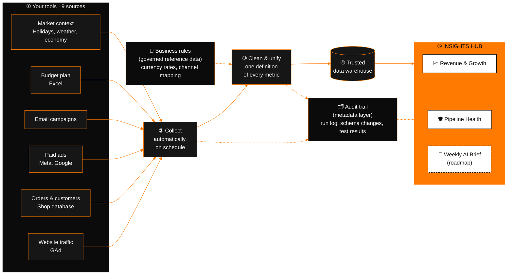

<div align="center">

# 🟠 Monday-morning revenue answers, automated

**Six tools. Two versions of the truth. One analyst losing every Monday to spreadsheets.**<br>
This project replaces that with one trusted Insights Hub.



</div>

---

## The problem is real

DTC and e-commerce teams really do have **scattered data**: ads, email, web analytics, orders, budget.

- Marketing's revenue and Finance's revenue **disagree**.
- Someone spends **hours every Monday** answering *"why did revenue move?"*

## The fix: automate the mess

> Take messy data from many sources, put it in **one Insights Hub**, and make decisions **quickly on Monday**, from data, not from guesswork.



---

## How the data moves



---

## What the Insights Hub gives decision makers

| You ask | The Hub shows | Why it matters |
|---|---|---|
| **Why did revenue move?** | A week-over-week *revenue bridge*: traffic, conversion, order value, promotions | Fix the right problem, not the loudest one |
| **Which channel pays back?** | Blended **ROAS, CAC, MER**, channel mix | Move budget to what works |
| **Are we on plan?** | Actual vs budget, tracked daily | No end-of-month surprises |
| **Who are our best customers?** | Cohort **lifetime value** | Spend to acquire the customers who stay |
| **Can I trust this?** | Pipeline Health: what ran, what failed, what's stale | Never present a wrong number |



---

## Data governance: why you can trust the numbers

| Governance need | How it's handled | Where it lives |
|---|---|---|
| **Single definition of each metric** (master / reference data) | Business rules such as currency rates and "which campaign belongs to which channel" are kept as small, version-controlled reference tables (*seeds*). Change a rule once, every report follows, and the change is reviewable | `fx_rates`, `campaign_mapping`, `budget_channel_mapping` |
| **Audit trail** (metadata layer) | Every data load, every schema change and every test result is logged, so you can answer *"what ran, when, and did it pass?"* | `meta.ingestion_log`, `meta.schema_changes`, `meta.dbt_run_results` |
| **Data quality** | 66 automated tests, 3 unit tests, and agreed *contracts* on the key tables so a bad change fails loudly instead of silently | dbt tests and contracts |
| **Reconciliation** | Orders match across the shop database, web analytics and the Hub (gap **1.8%**, tolerance 5%) | Singular tests |
| **Freshness and ownership** | Each source declares an owner and how stale it may get | Source definitions |
| **Privacy and access control** (PII) | Customer identifiers are hashed; the Hub connects with a read-only account that has row and time limits | Staging layer, ClickHouse users |
| **Lineage and documentation** | A browsable catalog shows where every number comes from | Data catalog at :8081 |
| **AI guardrails** | The planned AI brief must cite the numbers behind every claim, with cost and usage logged | Roadmap |

**In plain words:** the *seeds* are the company's agreed business rules, and the *meta layer* is the receipt for everything that happened to the data. Together they let you trace any number on a dashboard back to its source and to the rule applied.

## Try it

```bash
cp .env.example .env     # works as-is, no API keys needed
docker compose up        # then open http://localhost:8501
```

| | |
|---|---|
| Insights Hub | http://localhost:8501 |
| Pipeline scheduler | http://localhost:8080 |
| Data catalog and lineage | http://localhost:8081 |

> The demo company, **Kestrel Goods**, is fictional. Web traffic uses Google's public GA4 sample store; everything else is generated to match.

<details>
<summary><b>For the technical reader</b></summary>

dlt → ClickHouse → dbt (staging, intermediate, marts) → Streamlit, orchestrated by Airflow 3 (Assets + Cosmos). Docs: [context](docs/00_PROJECT_CONTEXT.md) · [architecture](docs/04_ARCHITECTURE.md) · [decisions](docs/DECISION_LOG.md) · [plan](docs/09_PROJECT_PLAN.md)

</details>
